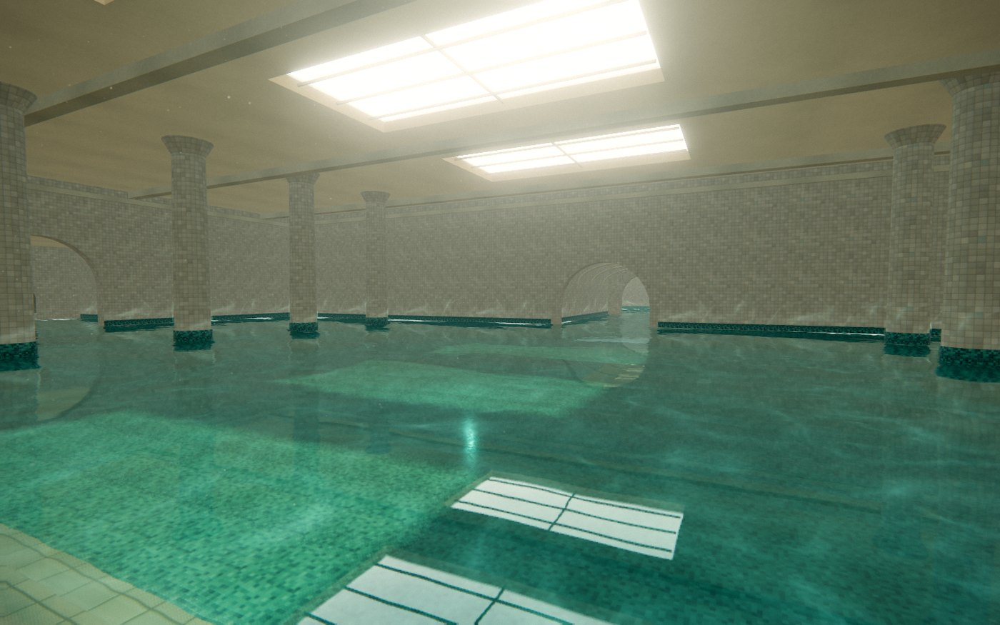
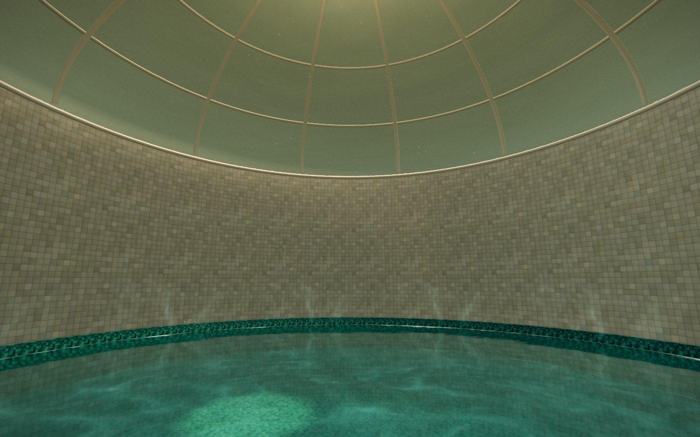
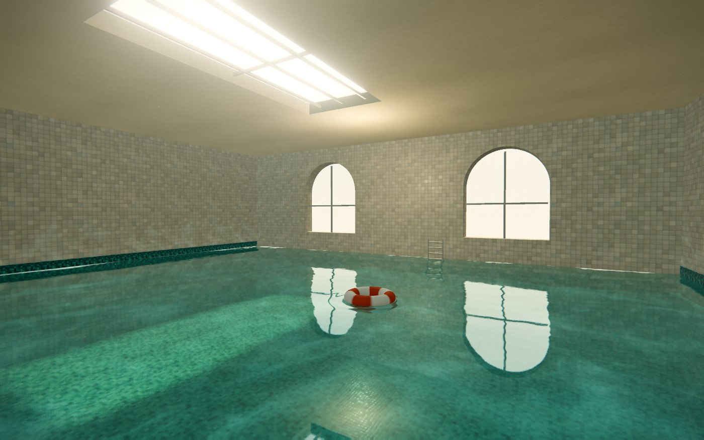

# POOLROOMS · 池核

一个以 **Poolrooms / 池核** 为视觉方向的 three.js 第一人称漫游场景：程序化瓷砖、实时平面反射池水、屏幕空间折射、水深吸收、动态焦散、天窗光柱、穹顶圆厅与涉水音效。所有贴图与音效都在运行时程序化生成，不依赖外部素材。



## 运行

需要 Node.js 18+：

```bash
npm install
python -m http.server 8123
# 打开 http://127.0.0.1:8123/
```

ES modules 必须通过静态服务器加载，直接双击 `index.html` 会失败。

## 操作

- 点击「进入水域」→ 锁定鼠标
- `WASD` / 方向键移动，`Shift` 加速，`Esc` 松开鼠标
- `M` 开关环境声
- 触屏设备自动进入拖动环视模式（OrbitControls）
- 调试：地址加 `?quality=low` 可降低分辨率与反射开销

## 场景

- **主池厅**：三组天窗、两排柱子、南侧平台与完全没入水下的入水台阶、壁龛、墙裙与檐口
- **东厅**：两扇拱窗、窗下石台、浮圈、扶梯
- **西柱厅**：浅水柱林，三组小方天窗
- **连廊**：拱肋、连续天窗、一条通往穹顶圆厅的过渡水廊
- **圆厅**：穹顶、顶部圆窗（oculus）、环形墙裙、顶光光柱
- 全图统一水面 `y = 0.3`；南侧平台（`y = 0.35`）保留约 5 cm 的干边，入水台阶完全在水下；各房间地坪高度 -0.55 ~ -0.10，水深约 0.4 ~ 0.85 m

## 技术要点

- 基于 `Reflector` 的自定义水体 Shader：平面反射、屏幕空间折射、程序化波法线、Fresnel、太阳高光、脚步/滴水涟漪、水雾
- 池底高度图（zones → 水深图）驱动湿区裁剪、深度吸收、浅水透色与岸线泡沫；水下不透明几何额外做统一水体染色
- 程序化 Canvas 贴图（白瓷砖、池底马赛克、灰泥、天空）+ 法线/粗糙度贴图 + PMREM 环境光
- 太阳方向光通过天窗、窗洞与 mullion 投射阴影；叠加上体积光柱与漂浮尘埃
- 后期：MSAA composer → UnrealBloom → ACES OutputPass → 自定义调色（对比、颗粒、暗角、色差）
- WebAudio 程序化环境声、涉水脚步与滴水
- 第一人称：Pointer Lock、涉水减速、自动上台阶、圆形/矩形碰撞、头部晃动；触屏用 OrbitControls 兜底

## 目录

```
index.html            页面、UI、importmap
src/main.js           渲染器、循环、UI 与调试接口
src/textures.js       程序化贴图 / 环境贴图
src/materials.js      材质装配
src/world.js          建筑、地形高度、碰撞体、灯光、焦散
src/config.js         共享水位等世界常量
src/water.js          反射/折射水面 Shader、水深图与涟漪系统
src/effects.js        光柱、尘埃、浮圈
src/player.js         第一人称移动与碰撞
src/postfx.js         后期链路
src/audio.js          程序化音效
```

## 修复记录

- **2026-11-25 · 不同高度池水台阶穿帮**（用户反馈，2026-11-24）：将水位由 `y = 0` 抬到 `y = 0.3`，使入水台阶完全没入水下，水面以上只与平台边缘、池壁和墙裙相交；配合水深图遮罩、屏幕空间折射、水下染色与岸线泡沫，消除了单平面水面横切台阶造成的干湿条带。细节见 [TODO.md](TODO.md)。

## 已知问题

- 视觉上仍偏灰、偏雾，瓷砖在远距离有摩尔纹；水下折射/反射静态截图下水面波纹不够明显，后续继续调。
- 尚未做 Firefox / Safari / 真机触屏验证；`?quality=low` 目前只降低分辨率与反射/折射采样，未做完整质量档位。

## 验证情况

已在 Windows + Chrome（Playwright，headless + D3D11）验证：资源加载、首帧渲染、指针锁定、WASD 移动、从平台下台阶涉水、控制台无报错、resize 无报错。1440×900、DPR 1、默认 4096 阴影预算下，4 秒采样约 180 fps（AMD Radeon 8060S，D3D11；仅作参考）。未做 Firefox / Safari、移动端手势与高 DPI 真机验证。



